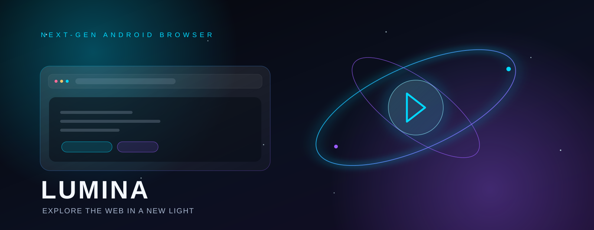

<!-- LUMINA README · Neon Glass -->

  

<h1 align="center">LUMINA BROWSER ✦</h1>

<strong>Explore the web. Keep your focus.</strong>

Android browser · Kotlin · Jetpack Compose · Material 3 · Gemini AI

  <a href="https://github.com/SKLEO62/Lumina">Repository</a> ·
  <a href="docs/FEATURES.md">Features</a> ·
  <a href="docs/BUILDING.md">Build guide</a> ·
  <a href="docs/SCREENSHOTS.md">Screenshots</a>

---

## ✦ About Lumina

**Lumina Browser** is an Android web browser built with **Kotlin**, **Jetpack Compose**, and **Material Design 3**. Its visual direction combines glassmorphism with a dark, cosmic atmosphere, while integrated Gemini-powered tools help turn web content into useful answers and tasks.

This repository's README documents the project as described by its current source and project configuration. Feature availability and behavior may change as development continues.

## ◈ What’s inside

| Area | Documented capabilities |
|---|---|
| **Lumina Intellect** | Gemini-powered chat for page summaries, key facts, simplified explanations, comparisons, fact-checking, translation, and questions about content |
| **Smart tasks** | Extract interactive task checklists from supported web content, including recipes and documentation |
| **Glassmorphism home** | Translucent start screen with adjustable wallpaper blur and dimming |
| **Personalization** | Built-in cosmic/abstract wallpapers, custom photo backgrounds, and five Material 3 palettes: Obsidian, Neon, Deep Space, Emerald, and Light |
| **Lumina Shield** | Ad and tracker blocking |
| **Private browsing tools** | Incognito tabs and a secure vault for passwords, history, and downloads, plus browsing-data cleanup |
| **Tabs & organization** | Regular and incognito tabs, grouped spaces, and pinned tabs |
| **Reading & utilities** | Reader mode, text-to-speech, QR code generation/scanning, and domain-linked web notes |

See [the feature guide](docs/FEATURES.md) for the detailed list.

## 🎨 Visual identity — Neon Glass

Lumina's project presentation uses a near-black space canvas with electric cyan (**#00D9FF**) and violet (**#9B5CFF**) accents. The banner is an original SVG asset stored in the repository and scales cleanly on desktop and mobile.

## 🧰 Technology

- **Language:** Kotlin
- **UI:** Jetpack Compose and Material Design 3
- **AI integration:** Firebase AI Logic / Gemini API
- **State and persistence:** SharedPreferences and StateFlow (as documented in the project README)
- **Architecture:** MVVM / Clean Architecture (as documented in the project README)

Build configuration currently declares **minSdk 24**, **targetSdk 36**, **versionCode 1**, and **versionName 1.0** in `app/build.gradle.kts`. These are configuration values, not a claim that a release APK has been built or tested.

## 🚀 Getting started

1. Clone or download this repository.
2. Open the project in Android Studio with Android/Gradle support.
3. Allow the IDE to sync the Gradle project and install the required Android SDK components.
4. Review the [build guide](docs/BUILDING.md), configure any required Firebase/Gemini setup locally, then run on an emulator or Android device.

> **Security note:** Never commit API keys, Firebase service credentials, signing keys, passwords, or local `.env` files. Use the provided `.env.example` as a reference and keep real secrets local.

## 📱 Screenshots

The repository currently uses a designed project banner; it does not claim that illustrative artwork is a real in-app screenshot. See [Screenshot guide](docs/SCREENSHOTS.md) for the recommended captures and the paths to add them when actual device/emulator screenshots are available.

## 🗺️ Roadmap

This README intentionally does not label unverified ideas as shipped features. Follow the repository's Issues and commit history for current work, bug reports, and planned improvements.

## 🤝 Contributing

Issues, bug reports, and focused pull requests are welcome. When reporting a problem, include:
- Device or emulator and Android version
- Steps to reproduce
- Expected behavior and what happened instead
- Relevant logs with tokens, personal data, and other secrets removed

## 📄 License

A license file was not confirmed during preparation of this README. Check the repository's `LICENSE` file before redistributing or reusing the project.

---

Made with focus, curiosity, and a little cosmic glow. ✦

